# figures

---

The repository hosts selected graphical material that [@rhododendrom](https://github.com/rhododendrom) and [@firefly-cpp](https://github.com/firefly-cpp) use for
teaching materials. The whole material is licensed under the CC-BY-SA-4.0 licence.

Feel free to use graphical material for your primary use (presentations,
papers, thesis) with correct attribution to this repository or the
primary source indicated for any specific figure from this repository.

# Cite us

Fister, Jr., I., & Fister, D. (2024). firefly-cpp/figures: 1.0 (1.0). Zenodo. [https://doi.org/10.5281/zenodo.10479320](https://doi.org/10.5281/zenodo.10479320)

# License

Shield: [![CC BY-SA 4.0][cc-by-sa-shield]][cc-by-sa]

Material in this folder is licensed under a
[Creative Commons Attribution-ShareAlike 4.0 International License][cc-by-sa].

[![CC BY-SA 4.0][cc-by-sa-image]][cc-by-sa]

[cc-by-sa]: http://creativecommons.org/licenses/by-sa/4.0/
[cc-by-sa-image]: https://licensebuttons.net/l/by-sa/4.0/88x31.png
[cc-by-sa-shield]: https://img.shields.io/badge/License-CC%20BY--SA%204.0-lightgrey.svg

# Thumbnails
[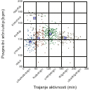](clustering/primer-grucenje-sport.pdf)
[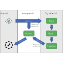](digital-twin/model-SI/digital-twin-model.svg)
[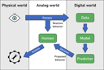](digital-twin/model-SI/digital-twin-model.png)
[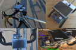](digital-twin/artificial-sport-trainer/ast-monitor.JPG)
[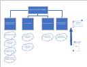](digital-twin/artificial-sport-trainer/ast-diagram-1.pdf)
[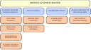](digital-twin/artificial-sport-trainer/ast-outline-1.pdf)

[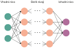](neural-network/nevronska-mreza-primer.pdf)
[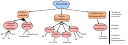](automl/si/niaaml.pdf)
[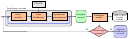](automl/si/automl.pdf)

[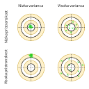](classification/VariancaPristranskost.pdf)
[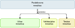](classification/PodatkovnaUcnaValidacijskaTestnaMnozica.pdf)
[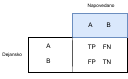](classification/metrike.pdf)
[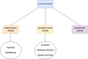](classification/podrocja-strojnega-ucenja.png)
[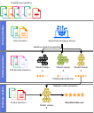](classification/MnozicaUcnaValidacijskaTestna.pdf)
[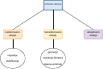](classification/podrocja-strojnega-ucenja.pdf)
[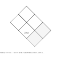](other/OS.svg)

[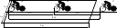](other/ironman-drafting.pdf)

[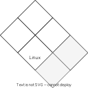](other/OS_no_attribution.svg)
[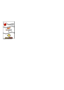](other/BSD_attribution.pdf)

[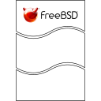](other/BSD.svg)
[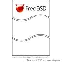](other/BSD_attribution.svg)
[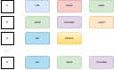](association-rule-mining/transaction-database.pdf)

[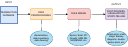](association-rule-mining/arm-pipeline.pdf)

[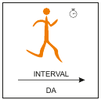](data-mining-in-sport/pismenka-interval.pdf)
[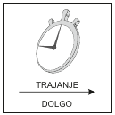](data-mining-in-sport/pismenka-trajanje.pdf)
[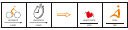](data-mining-in-sport/glyph_example.pdf)
[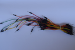](hardware/jumper-wires.JPG)
[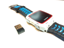](hardware/smart_watch_and_ant+.jpg)
[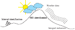](software-packages/sport-activities-features.pdf)
[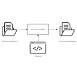](linux/awk_1.svg)
[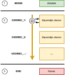](linux/awk_2.pdf)
[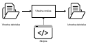](linux/awk_1.pdf)
[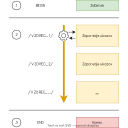](linux/awk_2.svg)
[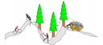](data-mining/rudar.png)

[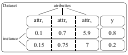](data-mining/DM_steps/Atributte_Instance.pdf)
[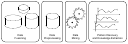](data-mining/DM_steps/DM_steps.pdf)

[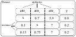](data-mining/DM_steps/Atributte_Instance_missing_data.pdf)
[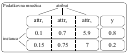](data-mining/DM_steps/Atribut_Instanca.pdf)

[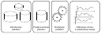](data-mining/DM_steps/DM_steps_slo.pdf)
[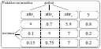](data-mining/DM_steps/Atribut_Instanca_missing_data.pdf)
[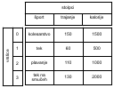](data-mining/preprocessing/Vrstice_stolpci.pdf)

[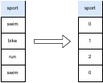](data-mining/preprocessing/ordinal-encoding.pdf)
[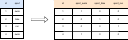](data-mining/preprocessing/one-hot-encoding.pdf)
[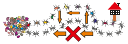](nature-inspired-algorithms/ants.pdf)
[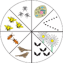](nature-inspired-algorithms/ring4.pdf)
[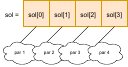](nature-inspired-algorithms/mapping.pdf)
[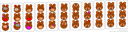](nature-inspired-algorithms/natural_evolution_bears_small.png)
[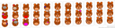](nature-inspired-algorithms/natural_evolution_bears.png)
[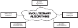](nature-inspired-algorithms/evolutionary_algorithms.pdf)
[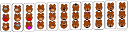](nature-inspired-algorithms/natural_evolution_bears.pdf)

